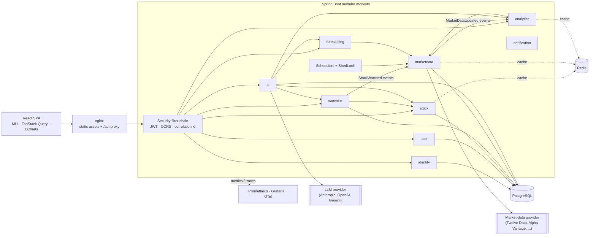
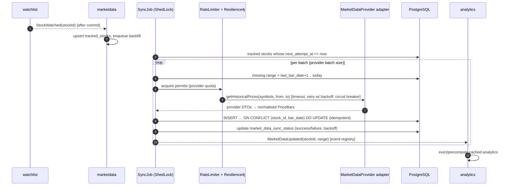
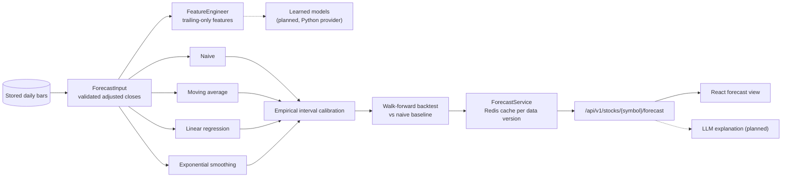
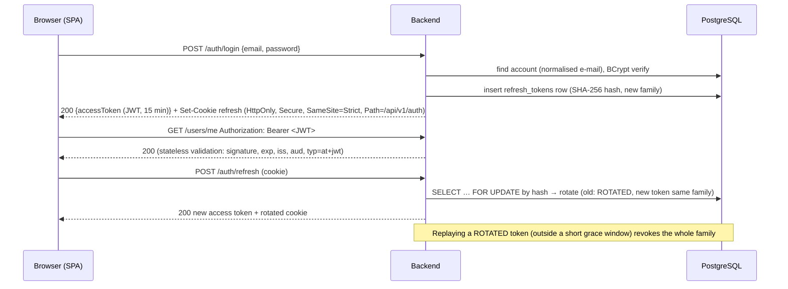

# Stock Forecast Platform — Architecture & Implementation Plan

> Status: **backend phases 1–4 (foundation, stocks & watchlists, market data, analytics) and frontend phases 1–3
> (shell, authentication, dashboard, watchlists, search) implemented.** Later phases are designed here and
> implemented incrementally; ✅ marks what exists today.
> Forecasts and AI-generated analysis are informational only and should not be considered financial advice.

Contents

1. [System architecture](#1-system-architecture)
2. [Module boundaries](#2-module-boundaries)
3. [Package structure](#3-package-structure)
4. [Database schema](#4-database-schema)
5. [Domain models](#5-domain-models)
6. [REST API design](#6-rest-api-design)
7. [Market-data ingestion](#7-market-data-ingestion)
8. [Analytics](#8-analytics)
9. [Forecasting](#9-forecasting)
10. [LLM integration](#10-llm-integration-grounded-ai)
11. [Frontend](#11-frontend)
12. [Authentication model](#12-authentication-model)
13. [Caching](#13-caching)
14. [Scheduling](#14-scheduling)
15. [Testing strategy](#15-testing-strategy)
16. [Docker & local development](#16-docker--local-development)
17. [Maven dependencies](#17-maven-dependencies)
18. [Roadmap](#18-phased-roadmap)

---

## 1. System architecture

A **modular monolith**: one Spring Boot deployable, internally split into business modules with enforced
boundaries, a React SPA, PostgreSQL as the system of record and Redis for caching and distributed rate limits.



Request path vs. data path are deliberately separated: **no user request ever calls a market-data provider
synchronously**. Providers feed a background ingestion pipeline; APIs read from PostgreSQL/Redis.

### Key decisions and trade-offs

| Decision | Why | Trade-off accepted |
|---|---|---|
| Modular monolith (Spring Modulith-verified) instead of microservices | One deployable, local transactions, cheap refactoring; boundaries are still enforced by tests (`ModularityTest`) so modules can be extracted later | Modules scale together; a noisy module (e.g. ingestion) shares the JVM — mitigated by bulkheads and, later, by running jobs on a dedicated instance profile |
| Java 25 + Spring Boot 4.1 | Current LTS JDK and current Spring generation (Framework 7, Security 7, Jackson 3, Hibernate 7) | Newer ecosystem: a few libraries (e.g. Resilience4j, Spring AI) must be checked for Boot 4 support per phase |
| Virtual threads for request handling | I/O-bound workload; no thread-pool tuning; JDK 24+ removed `synchronized` pinning | DB concurrency is bounded by the Hikari pool, which must be sized deliberately |
| JPA annotations on domain types | Avoids a parallel persistence model and mapping layer | Domain is not 100% framework-free; ArchUnit forbids every *other* framework dependency in `domain` |
| Spring Data repositories implement domain ports directly | No hand-written adapters, domain owns the interface | Port method names must follow Spring Data conventions |
| Domain-generated UUIDv7 ids | Aggregates own identity before persistence; time-ordered → index-friendly; unguessable | 16-byte keys; high-volume time series use natural composite keys instead |
| Synchronous in-transaction events for invariants, async events for reactions | Atomicity where needed (account + profile), decoupling elsewhere | Must choose consciously per listener |
| Custom error envelope (as specified) instead of RFC 9457 | Matches product contract; stable machine codes | Not a standard media type; can be mapped to Problem Details later |

---

## 2. Module boundaries

Each module is a top-level package under `com.stockforecast`. Its **top-level package is its published API**;
sub-packages are internal and may not be referenced by other modules (verified by Spring Modulith).
Module dependencies must be acyclic.

| Module | Responsibility | Owns tables | Published API (examples) | Depends on |
|---|---|---|---|---|
| `shared` (open) | Error model, `DomainException`, ids, correlation id, clock, OpenAPI | – | `ApiError`, `DomainException`, `Identifiers` | – |
| `identity` ✅ | Accounts, credentials, sessions (refresh tokens), JWT, HTTP security | `users`, `refresh_tokens` | `AuthenticatedUser`, `@CurrentUser`, `Role`, `UserRegisteredEvent` | shared |
| `user` ✅ | Profile and preferences (display name, time zone) | `user_profiles` | – | identity, shared |
| `stock` ✅ | Canonical securities catalogue, search, metadata | `stocks` | `StockCatalog`, `StockRef`, `UnknownStockException` | shared |
| `watchlist` ✅ | User watchlists and items, ownership, limits, starter list | `watchlists`, `watchlist_items` | `WatchlistQueries`, `StockAddedToWatchlist` event | identity, stock |
| `marketdata` ✅ | Provider port/adapters, ingestion, stored price history, sync status | `market_prices`, `market_data_sync_status`, `shedlock` | `PriceHistory`, `DailyBar`, `MarketDataStatus` | stock, watchlist |
| `quant` ✅ | Pure financial math shared by analytics and forecasting (metric definitions, trailing indicators) | – | `PriceSeries`, `NormalizedSeries`, `Indicators` | – |
| `analytics` ✅ | Returns, risk, momentum, normalised performance, dashboard | – (Redis cache only) | – (REST only) | marketdata, stock, watchlist, identity, quant |
| `forecasting` ✅ | Forecast model SPI, statistical models, interval calibration, walk-forward backtesting, feature engineering | – (Redis cache only, see §9) | – (REST only; a query API for `ai` comes with phase 8 of the forecasting plan) | marketdata, stock, quant |
| `ai` | Grounded Q&A, conversations, LLM port/adapters, cost control | `ai_conversations`, `ai_messages`, `ai_usage_daily` | – | identity, watchlist, stock, analytics, forecasting |
| `notification` | Future alerts (price thresholds, digests) | `notifications` (future) | – | listens to events |

Rules of engagement:

* Cross-module references are **by id** (e.g. `stock_id`), never by JPA association across modules.
* Ownership is derived from `AuthenticatedUser.id()`; no API accepts a user id for user-scoped data.
* External-provider types (DTOs of Twelve Data, Anthropic, …) never leave their adapter package.
* A cross-module foreign key is allowed for integrity in the shared database (documented in each migration).

---

## 3. Package structure

```text
backend/src/main/java/com/stockforecast
├── StockForecastApplication.java
├── shared/                       # open module
│   ├── domain/                   # DomainException, ErrorCategory, Identifiers (UUIDv7)
│   ├── api/                      # ApiError, GlobalExceptionHandler, ApiErrorController, writers
│   ├── web/                      # CorrelationIdFilter, CORS
│   └── config/                   # Clock, OpenAPI
├── identity/
│   ├── AuthenticatedUser, CurrentUser, Role, UserRegisteredEvent   # published API
│   ├── domain/                   # UserAccount, RefreshToken, EmailAddress, PasswordPolicy, ports, exceptions
│   ├── application/              # RegistrationService, AuthenticationService, UserSessionService, ports
│   ├── infrastructure/
│   │   ├── persistence/          # Spring Data implementations of the ports
│   │   ├── security/             # filter chain, JWT encoder/decoder, converters, entry points
│   │   └── bootstrap/            # first-admin provisioning
│   └── api/                      # AuthController, AdminUserController, DTOs, refresh cookie
├── user/                         # same layering: domain / application / infrastructure / api
├── stock/                        # catalogue, ranked search (Redis-cached)
├── watchlist/                    # aggregate with items; published WatchlistQueries + StockAddedToWatchlist
├── marketdata/                   # provider port, infrastructure/provider/<vendor>/ adapters, JDBC store, ShedLock job
├── quant/                        # PriceSeries, Indicators: pure metric definitions shared by analytics & forecasting
├── analytics/                    # snapshots, rebased performance, dashboard composition
├── forecasting/                  # domain/{model,backtest,feature}: models, walk-forward backtester, features
├── ai/                           # Phase 7 (infrastructure/llm/<vendor>/ holds adapters)
└── notification/                 # later
```

Layer rules (ArchUnit, `LayeredArchitectureTest`): `api → application → domain`, `infrastructure → application/domain`;
`domain` must not depend on Spring, servlet or JSON libraries; `api` must not touch `@Entity` types or repositories.

---

## 4. Database schema

PostgreSQL 18, Flyway-managed (`backend/src/main/resources/db/migration`), Hibernate in `validate` mode.
Timestamps are `TIMESTAMPTZ` (UTC), money is `NUMERIC`, never floating point.

### Implemented (Phase 1)

```text
users                 id UUID PK, email VARCHAR(320) UNIQUE CHECK (normalised), password_hash, role CHECK (USER|ADMIN),
                      enabled, created_at, updated_at, version
                      IX users(created_at)
refresh_tokens        id UUID PK, user_id FK→users ON DELETE CASCADE, family_id UUID, token_hash VARCHAR(64) UNIQUE,
                      issued_at, expires_at, session_expires_at, revoked_at, revocation_reason, version
                      CHECK expires_at ∈ (issued_at, session_expires_at]; CHECK revoked_at/reason consistent
                      IX (user_id); partial IX (family_id) WHERE revoked_at IS NULL; IX (expires_at)
user_profiles         user_id PK FK→users ON DELETE CASCADE, display_name, time_zone, created_at, updated_at, version
```

### Implemented (phases 2–4)

```text
refresh_tokens            + persistent BOOLEAN ("remember me", carried across rotations)            (V3)
stocks                    id UUID PK, symbol UNIQUE CHECK upper-case, company_name, aliases (former/colloquial names),
                          exchange, mic, currency, country, sector, industry, asset_type CHECK, active, ...  (V4, seeded)
                          partial IX (sector) WHERE active
watchlists                id UUID PK, user_id FK→users ON DELETE CASCADE, name, created_at, updated_at, version  (V5)
                          UNIQUE (user_id, lower(name)); IX (user_id, created_at)
watchlist_items           id UUID PK, watchlist_id FK ON DELETE CASCADE, stock_id FK→stocks, added_at, notes, version
                          UNIQUE (watchlist_id, stock_id); IX (stock_id)  -- "which stocks are watched"
market_prices             stock_id FK, bar_date DATE, open/high/low/close/adjusted_close NUMERIC(19,6) CHECK > 0,
                          volume BIGINT, data_provider, ingested_at                                    (V6)
                          PRIMARY KEY (stock_id, bar_date)  -- idempotent upserts, efficient range scans
                          (range-partition by year once volume warrants it)
market_data_sync_status   stock_id PK, provider, last_bar_date, last_success_at, last_attempt_at, sync_started_at (lease),
                          consecutive_failures, last_error, next_attempt_at (backoff)
shedlock                  name PK, lock_until, locked_at, locked_by
```

### Planned

```text
ai_conversations          id UUID PK, user_id FK→users ON DELETE CASCADE, title, created_at, updated_at, version
                          IX (user_id, updated_at DESC)
ai_messages               id UUID PK, conversation_id FK ON DELETE CASCADE, role, content TEXT, grounding JSONB,
                          model, input_tokens, output_tokens, created_at   IX (conversation_id, created_at)
ai_usage_daily            user_id, usage_date, requests, input_tokens, output_tokens  PK (user_id, usage_date)
event_publication         Spring Modulith event publication registry (transactional outbox), when events must
                          survive crashes (today a lost backfill event is recovered by the daily synchronisation)
```

Derived metrics are **not persisted** initially: five years of daily bars is ~1,260 rows per stock and computes in
microseconds; results are cached (see §13). A `stock_metric_snapshots` table is the documented escape hatch if
profiling ever shows the dashboard needs precomputation.

---

## 5. Domain models

| Module | Aggregates / entities | Value objects & services |
|---|---|---|
| identity ✅ | `UserAccount`, `RefreshToken` (family-linked chain) | `EmailAddress` (normalised), `PasswordPolicy`, `Role`, `RevocationReason` |
| user ✅ | `UserProfile` (1:1 with account, keyed by user id) | validated display name, IANA time zone |
| stock | `Stock` (canonical security, shared by all users) | `Ticker` (symbol + exchange MIC), `AssetType` |
| watchlist | `Watchlist` (root) → `WatchlistItem` | invariants: owner, unique stock per list, max lists/items per user (bounds provider cost) |
| marketdata | `SyncStatus`, `TrackedStock` | `PriceBar` (date, OHLC, adjusted close, volume), `PriceSeries` (ordered, gap-aware), `Quote`, `MarketDataProvider` port |
| analytics | – (stateless) | `PerformanceMetrics`, `RiskMetrics`, `TechnicalIndicators`, `NormalizedSeries`, `AnalyticsPeriod` (1D…MAX, custom) |
| forecasting | – | `ForecastRequest`, `ForecastResult`, `ForecastPoint`, `ModelMetrics`, `StockForecastModel` SPI |
| ai | `AiConversation` → `AiMessage` | `GroundingContext` (facts + provenance), `LlmRequest`/`LlmResponse`, `LlmProvider` port |

Numeric policy: prices are `BigDecimal` end-to-end (storage, API). Statistics (returns, volatility, regression)
are computed in `double` — they are approximations by nature and need `Math.log/sqrt` — and are rounded on output
(ratios to 6 decimals). Returns are decimal fractions (`0.12` = 12 %).

---

## 6. REST API design

Conventions: `/api/v1` URI versioning · JSON · ISO-8601 UTC instants and `yyyy-MM-dd` dates · `ApiError` envelope
with stable `code` · Bean Validation on all inputs · pagination `?page=0&size=20&sort=field,dir` returning
`{content, page:{number,size,totalElements,totalPages}}` · resources owned by another user answer **404** (no
existence disclosure) · OpenAPI at `/v3/api-docs`, Swagger UI at `/swagger-ui.html` (disabled in prod by default).

| Phase | Method & path | Purpose |
|---|---|---|
| 1 ✅ | `POST /auth/register` · `POST /auth/login` | create account / sign in → access token (body) + refresh cookie |
| 1 ✅ | `POST /auth/refresh` · `POST /auth/logout` | rotate session / revoke session (cookie-based) |
| 1 ✅ | `GET /users/me` · `PATCH /users/me` | own profile |
| 1 ✅ | `GET /admin/users/statistics` | ADMIN: user counts |
| 2 ✅ | `GET /stocks/search?q=apple&limit=8` · `GET /stocks?sector=&page=&size=` · `GET /stocks/sectors` · `GET /stocks/{symbol}` | ranked catalogue search (Redis-cached), browsing |
| 2 ✅ | `GET/POST /watchlists` · `GET/PATCH/DELETE /watchlists/{id}` | own watchlists (max 20; names unique per user) |
| 2 ✅ | `POST /watchlists/{id}/items` · `PATCH/DELETE /watchlists/{id}/items/{symbol}` | add/annotate/remove stocks (max 50 per list) |
| 3 ✅ | `GET /stocks/{symbol}/prices?period=1Y` · `GET /market-data/provider` | stored daily bars with data status; active provider (synthetic flag) |
| 3 | `POST /stocks/{symbol}/refresh` → `202` | controlled async refresh (deduplicated, rate-limited) |
| 3 | `GET /admin/market-data/sync-status` · `GET /admin/market-data/providers` | ingestion monitoring |
| 4 ✅ | `GET /stocks/{symbol}/analytics` · `GET /analytics/snapshots?symbols=` | price, change, 1W–1Y/YTD returns, 30/90-day volatility, 1Y drawdown, RSI(14), 3M momentum |
| 4 ✅ | `GET /analytics/performance?symbols=&period=` | series rebased to 100 (weekly points for 5Y/MAX) |
| 4 | `GET /stocks/{symbol}/indicators?period=1Y&sma=20,50,200` | chart overlay series |
| 4 | `GET /analytics/compare?symbols=AAPL,MSFT,NVDA&period=6M` | 2–5 stocks: metrics table + series normalised to 100 |
| 5 ✅ | `GET /dashboard?period=1M[&watchlistId=]` | watched stocks with metrics, movers, performance chart, data freshness |
| 6 | `GET /stocks/{symbol}/forecast?model=linear-trend&horizon=30` · `GET /forecasts/models` | statistical forecast + diagnostics |
| 7 | `GET/POST /ai/conversations` · `GET/DELETE /ai/conversations/{id}` | own conversations |
| 7 | `POST /ai/conversations/{id}/messages` | ask a grounded question |

---

## 7. Market-data ingestion



* **Port** (`marketdata.application`): `getQuote`, `getHistoricalPrices`, `searchStocks`, plus `capabilities()`
  (batch size, requests/minute, daily quota). The configured adapter is selected by `MARKET_DATA_PROVIDER`;
  credentials come from `MARKET_DATA_API_KEY`. First adapter: Twelve Data (batch-capable, workable free tier);
  Alpha Vantage second. Current plan limits must be verified when implementing.
* **Only watched stocks are synced.** The job asks the watchlist module (`WatchlistQueries`) for the watched set;
  `StockAddedToWatchlist` triggers an immediate asynchronous backfill after the watchlist transaction commits, so a
  freshly added stock has five years of history within seconds. Trade-off: without an event outbox a crash can
  lose that trigger; the daily (and start-up) synchronisation then catches up.
* **Concurrency without a held connection**: a short transaction takes a per-stock lease
  (`sync_started_at`, taken over when stale), the provider is called outside any transaction, and a second short
  transaction upserts the bars and records success — no DB connection is held during network calls, and two
  instances never synchronise the same stock at once.
* **Synthetic provider ✅**: deterministic geometric Brownian motion per symbol for development and demos, released
  like an end-of-day feed (after 21:00 UTC). It reports `synthetic: true` so every client labels the data as
  simulated; production must configure a licensed provider.
* **Rate limits**: Bucket4j token bucket per provider sized from `capabilities()` (Redis-backed in multi-instance
  deployments) — requests wait for permits instead of failing. **Resilience**: Resilience4j time limiter, retry with
  exponential backoff + jitter (only for timeouts/5xx/429), circuit breaker per provider, bulkhead.
* **Idempotency**: natural key upserts; re-running a sync is harmless. Split/dividend adjustments are handled by
  periodically re-fetching a trailing window and a full refresh when the provider reports corporate actions.
* **Failures**: per-stock exponential backoff via `next_attempt_at`, structured logs with provider/symbol/error
  code, metrics `market_data_requests`, `market_data_failures`, `market_data_sync_duration`, `market_data_last_success`.
* **Manual refresh** enqueues the same pipeline (202 Accepted); duplicates within a cool-down are no-ops.
* **Intraday** (1D/5D charts) uses a separate retention-limited table once a provider plan supports it.

---

## 8. Analytics

Pure, deterministic calculators in the `quant` module operate on an immutable `PriceSeries` (adjusted closes) and
know nothing about HTTP, JPA or caching; an application service loads series, applies periods and caches results.
`quant` is shared with forecasting (one definition of every indicator) so neither module depends on the other.

| Metric | Definition |
|---|---|
| Simple return over [t₀, t₁] | `P(t₁)/P(t₀) − 1` (adjusted close); periods 1D, 1W, 1M, 3M, 6M, YTD, 1Y, custom |
| Daily log return | `rₜ = ln(Pₜ / Pₜ₋₁)` |
| Volatility (annualised) | sample std-dev of daily log returns × √252; windows 30d / 90d / period |
| Max drawdown | `min_t (Pₜ / max_{s≤t} P_s − 1)`; current drawdown from running peak |
| SMA n (20/50/200) | arithmetic mean of last n closes; series for chart overlays |
| RSI(14) | Wilder's smoothing of average gains/losses |
| Rate of change n | `Pₜ / Pₜ₋ₙ − 1`; momentum score combines ROC(63/126) and SMA50/SMA200 crossover state |
| Normalised performance | `100 × Pₜ / P(t₀)` for comparison charts |

Every result carries `asOf` (last bar date) and a data status, and metrics are `null` when the history is too
short instead of returning misleading numbers. Unit tests assert against golden values computed independently.
Implemented ✅ in `PriceSeries` (returns, annualised volatility, maximum drawdown, Wilder RSI, rate of change,
rebasing to 100); snapshots are cached in Redis keyed by stock and data version (time of the last successful
synchronisation), so new data invalidates them without explicit eviction.

---

## 9. Forecasting

Implemented ✅ (forecast phases 1–3 and the initial UI). Forecasts are **statistical estimates with uncertainty
ranges**, never predictions: every response and view carries the disclaimer *"Forecasts are based on historical
data and statistical models. They are informational only and are not financial advice."*



**Layers.** `domain` is framework-free (Hipparchus for numerics): `ForecastInput` (validated history: strictly
ascending dates, positive finite adjusted closes, `truncate(n)` = what was known at observation `n-1`),
`ForecastRequest` (target, horizon in trading days, confidence, model parameters), `StockForecastModel` (SPI),
`ModelForecast` (price path with ranges, fitted values, notes), `TradingCalendar` (weekdays), `ForecastBacktester`.
`application` holds the `ForecastProvider` port, `ForecastService` and `ForecastProperties`; `infrastructure` wires
models as beans (`JavaForecastProvider`) and the Redis caches; `api` exposes three read endpoints.

```java
public interface StockForecastModel {
    ForecastModelType type();
    Set<ForecastTarget> supportedTargets();            // PRICE and RETURN for price-path models
    List<ParameterSpec> parameters();                  // tunables, described for clients
    ModelParameters resolveParameters(ModelParameters requested);   // validates, fills defaults
    int minimumObservations(ModelParameters parameters);
    ModelForecast forecast(ForecastInput input, ForecastRequest request);
}
```

| Model | Central path | Notes |
|---|---|---|
| `NAIVE` | last close | the baseline; optimal point forecast for a random walk; makes no directional call |
| `MOVING_AVERAGE` | mean of the last `window` closes (5–200, default 20), flat | reuses `quant.Indicators.sma` |
| `LINEAR_REGRESSION` | OLS of log price on time over the last `lookback` closes (60–1260, default 252), extrapolated | Hipparchus `SimpleRegression`; reports intercept, slope, R², annual trend |
| `EXPONENTIAL_SMOOTHING` | simple, Holt linear or damped trend on log prices; `AUTO` = lowest AICc | initial state solved exactly by least squares (errors are affine in it); weights by Brent/BOBYQA from a bounds-inclusive grid, multi-start; matches statsmodels to 1e-10 |
| `MONTE_CARLO`, `ARIMA` | – | listed as planned; requests are rejected (`UNSUPPORTED_FORECAST_MODEL`), never answered by a stand-in |

Holt-Winters is deliberately not offered: daily equity prices have no stable seasonal cycle.

**Uncertainty ranges.** Textbook OLS/ETS intervals assume independent residuals and are badly overconfident on
prices. Instead every model's ranges come from its *own* out-of-sample errors: over the last 250 origins of the
training data the model forecasts from each origin (using only data up to it) and the root-mean-square log error
at each step `k` gives `s(k)`; the range is `F(k) · exp(±z · s(k))` with `z` the normal quantile of the confidence
level (80% by default). Steps with fewer than 20 measured errors are extrapolated with `√k`, scales are
non-decreasing, and the method is reported (`EMPIRICAL`, `EMPIRICAL_EXTRAPOLATED`, `VOLATILITY_SCALED`).
Exponential smoothing calibrates with its fitted weights fixed (one recursion pass); that in-sample choice of
weights makes its ranges slightly optimistic, which the backtest coverage exposes.

**Backtesting (walk-forward).** Origins every 5 trading days over the last 250 days whose outcome is known; the
earliest origin must have the minimum history (250). At each origin the model is refitted on
`input.truncate(origin + 1)` — it never receives a later observation, so parameter estimation, interval calibration
and any features are leakage-free by construction (tests assert both the training cut-off and that altering the
future leaves earlier forecasts bit-identical). There is no random split. Metrics on the horizon-step forecast:
MAE, RMSE, mean error, MAPE and sMAPE (prices only; returns near zero make them explode), direction accuracy over
actual up/down calls (plus the up-move share as the "always up" reference), range coverage, and skill
`1 − RMSE/RMSE(naive)` with a qualitative comparison (±5% = similar). Every forecast response embeds the backtest
of exactly its configuration; when history is too short for one it says so instead of hiding the forecast.

**Features.** `FeatureEngineer` builds returns, log returns, SMA 5/10/20/50/200, EMA 12/26, RSI 14, 20-day momentum
and volatility, volume change, price/SMA20, SMA20/SMA50 and 20-day high/low from `quant.Indicators` — all trailing,
no whole-dataset normalisation — for the `MachineLearningForecastModel` extension point.

**API** (`/api/v1/stocks/{symbol}/forecast`): `GET` (params `model`, `target`, `horizon`, plus `window` |
`lookback` | `variant`, `alpha`, `beta`, `phi`), `GET /backtest` (every evaluated forecast), `GET /models` (catalogue
with explanations, parameters, availability and the stock's history status). Errors: `INSUFFICIENT_FORECAST_HISTORY`
(422, `details.requiredObservations/availableObservations/dataStatus`), `UNSUPPORTED_FORECAST_MODEL`,
`UNSUPPORTED_FORECAST_TARGET`, `INVALID_FORECAST_HORIZON`, `INVALID_FORECAST_PARAMETER` (400).

**Caching and execution.** Results and backtests are cached in Redis under
`stock:model:target:horizon:parameters:settings-fingerprint:data-version` (data version = time of the last
successful sync), so new market data makes old forecasts unreachable. Execution is synchronous: the most expensive
configuration (exponential smoothing `AUTO` including its 50-origin backtest on ~1,300 bars) takes ~0.25 s, cache
hits ~30 ms. Heavier engines (Monte Carlo with 10,000 paths, ARIMA order search, ML) should run on a bounded worker
executor behind the same service, with single-flight de-duplication of identical in-flight requests and results
persisted for reuse — no distributed infrastructure needed for that step.

**Extension points.**
* *Another engine*: implement `ForecastProvider` (e.g. `PythonMlForecastProvider` over REST/gRPC returning the same
  domain types, backtesting next to the model); `ForecastService` routes by `supportedModels()`.
* *Another Java model*: declare a `StockForecastModel` bean; it is served, backtested and listed automatically.
* *Next phases*: model comparison and automatic selection by backtest RMSE/MAE ("best historical backtest", never
  "best future model"), inverse-RMSE ensembles, persisted evaluation history (`forecast_runs`, `model_evaluations`),
  Monte Carlo (GBM with drift/volatility from returns, percentile bands P10–P90, seeded tests), ARIMA from an
  established library, and the LLM context builder that explains — but never computes — forecasts.

---

## 10. LLM integration (grounded AI)

```mermaid
flowchart LR
    Q[User question] --> R["Intent resolver<br/>symbols · period · intent"]
    R --> E["Entitlements<br/>symbols exist · 'my watchlist' = principal's"]
    E --> F["Facts assembler<br/>analytics · forecasting (deterministic)"]
    F --> G["GroundingContext JSON<br/>+ data timestamp + provenance"]
    G --> P["Prompt builder<br/>system rules · history · facts as data"]
    P --> L["LlmProvider port<br/>timeout · retry · circuit breaker"]
    L --> V["Answer validator<br/>numbers must appear in facts"]
    V --> O["Response: answer, stocksAnalyzed, period,<br/>dataTimestamp, metrics, disclaimer"]
```



* **Port**: `LlmProvider.generate(LlmRequest) → LlmResponse` (content, model, token usage, finish reason).
  Adapters per vendor (Anthropic first, then OpenAI/Gemini) selected by `ai.provider`; keys from
  `ANTHROPIC_API_KEY`/`OPENAI_API_KEY`/`GEMINI_API_KEY`. Spring AI may be used *inside* adapters; its types never
  leave them.
* **Grounding**: every number the model may use is computed by analytics/forecasting and passed as JSON. The system
  prompt requires: use only supplied statistics for numerical claims; no invented prices, ratios, news, ratings,
  earnings or forecasts; separate facts from interpretation; say which data is missing.
* **Validation**: numeric tokens in the answer are checked against the facts (with rounding tolerance); violations
  trigger one constrained regeneration, then a safe fallback summary built from the facts alone.
* **Prompt-injection hygiene**: user text only in user messages; facts delimited as data; tool output never
  executed; no secrets in prompts.
* **Conversations**: `AiConversation` belongs to exactly one user (all queries scoped by principal id; foreign
  ids → 404). Follow-ups ("which one was less volatile?") reuse the previous turn's grounding (symbols, period)
  plus the last N messages; only question, answer, grounding snapshot and token counts are persisted.
* **Cost control**: per-user request rate limit and daily token budget (`ai_usage_daily`), max input/output
  tokens, provider timeouts, metrics `llm_requests`, `llm_failures`, `llm_latency`, `llm_token_usage`.

---

## 11. Frontend

```text
frontend/src
├── app/            # router, providers (QueryClient, MUI theme), auth context, route guards
├── api/            # OpenAPI-generated types, fetch client: bearer header, single-flight refresh (Web Locks), errors
├── features/
│   ├── auth/       # login, register
│   ├── dashboard/  # cards, watchlist performance chart, recent AI analysis
│   ├── watchlists/ # list/edit, add stock via search
│   ├── stocks/     # details: price/candlestick + SMA overlays + volume, metrics, forecast chart
│   ├── compare/    # 2–5 symbols: metrics table, normalised chart, "ask AI about this comparison"
│   ├── ai/         # conversations, grounded answers with data timestamp & metrics
│   └── profile/
├── components/     # Disclaimer, MetricCard, PeriodSelector, ErrorState, charts/*
└── lib/            # Intl number/currency/percent formatting, dates
```

Implemented ✅ (phases 1–3): React 19 + TypeScript 6 + Vite 8, MUI 9, TanStack Query 5 (server state only; no
global client store), React Router 8 with lazy, code-split routes, Axios, React Hook Form + Zod 4, Apache ECharts 6
(one library for line/candlestick, overlays, volume, bands and comparison charts; loaded lazily).

* **Auth**: access token in memory only; HttpOnly refresh cookie the SPA never sees. One HTTP client owns bearer
  headers, refresh-and-retry on 401 (single flight, Web Locks across tabs) and error normalisation; the
  `AuthProvider` restores the session on load and reacts to expiry; route guards redirect and return.
* **Server state**: query keys in one place, invalidation after mutations, polling only while newly watched stocks
  are still `PENDING`.
* **Tests**: Vitest + Testing Library + MSW against the real route tree and providers; unhandled requests fail.
  Playwright smoke tests against Docker Compose are planned.
* **Delivery**: in Docker the SPA is served by unprivileged nginx (CSP without `unsafe-eval`, immutable asset
  caching) which proxies `/api`, making the API same-origin.

---

## 12. Authentication model

Implemented in Phase 1.



* **Access token**: HS256 JWT minted by Spring Security's `NimbusJwtEncoder`, validated by the OAuth2 resource-server
  filter (no custom JWT filter). Claims: `sub` (user id), `email`, `roles`, `iss`, `aud`, `iat`, `nbf`, `exp`, `jti`;
  header `typ=at+jwt` (RFC 9068) so other JWTs can't be replayed as access tokens; 30 s clock skew.
* **Refresh token**: 256-bit opaque random value, stored only as SHA-256, single use with rotation, reuse
  detection, 7-day sliding expiry capped by a 30-day absolute session lifetime, revoked on logout.
* **Passwords**: BCrypt (work factor 12) behind a `DelegatingPasswordEncoder` (algorithm prefix, transparent rehash
  on login); policy 12 chars – 72 bytes; constant-work login path for unknown e-mails.
* **Authorization**: deny-by-default filter chain; `ADMIN` required on `/api/v1/admin/**` and via `@PreAuthorize`;
  ownership always from the principal. The `/api/v1/auth/**` endpoints ignore `Authorization` headers, so a client
  still sending an expired access token can always refresh or sign out.
* **Known trade-offs**: an access token stays valid until expiry (≤ 15 min) after logout or role change;
  HS256 uses one shared key (move to RS256/ES256 + JWKS with key rotation when another service must verify tokens);
  e-mail verification, password reset and login rate limiting are on the roadmap.

---

## 13. Caching

Redis via Spring's cache abstraction (`RedisCacheManager`) ✅. Each module declares its caches next to the code
(name, value type, TTL) and values are stored as JSON with an explicit type per cache. A logging
`CacheErrorHandler` makes Redis an optimisation, never a dependency: when Redis is down, requests compute the value.
Keys include a **data version** where data changes (time of the last successful synchronisation). Implemented:
`stock-search` (1 h) and `stock-snapshot` (12 h, versioned); the rows below marked planned follow.

| Cache | Key | TTL |
|---|---|---|
| Stock search | `stock-search:{normalised query}` | 24 h |
| Stock metadata | `stock:{symbol}:{mic}` | 7 d |
| Latest quote | `quote:{stockId}` | 30–60 s |
| Analytics / indicators | `analytics:{stockId}:{period}:{dataVersion}` | 6 h |
| Comparison | `compare:{sorted stockIds}:{period}:{dataVersion}` | 6 h |
| Forecast | `forecast:{stockId}:{model}:{horizon}:{dataVersion}` | 6 h |
| Dashboard (user-private) | `dashboard:{userId}` | 30 s, evicted on watchlist change |

Never cached globally: anything user-specific without the user id in the key, AI answers, auth data.
Rate-limit buckets (providers, AI, search, login) also live in Redis.

---

## 14. Scheduling

| Job | Trigger | Notes |
|---|---|---|
| Daily price sync | cron after US/EU close (configurable), plus catch-up at startup | only tracked stocks; batched; idempotent |
| Quote refresh | every 1–5 min during market hours (configurable) | watched stocks only; skipped when markets closed |
| Backfill | event-driven (`StockWatched`) | asynchronous, rate-limited |
| Refresh-token cleanup | daily | delete tokens expired > 7 days |
| AI usage/conversation retention | daily | configurable retention |

`@Scheduled` alone would run every job on every instance, so jobs use **ShedLock** ✅ (JDBC lock table in PostgreSQL,
database time, `lockAtMostFor`/`lockAtLeastFor`); per-stock leases additionally prevent duplicate work between the
scheduled job, start-up catch-up and event-driven backfills. If one instance can no longer keep up, work is partitioned through a job table
consumed with `SELECT … FOR UPDATE SKIP LOCKED`. Events between modules use Spring Modulith's event publication
registry (transactional outbox) so a crash cannot lose "data updated" notifications.

---

## 15. Testing strategy

| Level | Tooling | Scope |
|---|---|---|
| Unit | JUnit 5, AssertJ, Mockito | domain rules, session rotation/replay, JWT round-trips, **all analytics and forecasting math** (golden datasets), LLM context/prompt construction, answer validation |
| Architecture | Spring Modulith `verify()`, ArchUnit | module boundaries, layering, no entities in API, no field injection, no generic exceptions |
| Persistence | `@DataJpaTest` + Testcontainers PostgreSQL | queries, locks, constraints, migrations |
| API / security | `@SpringBootTest` + MockMvc + Testcontainers | auth flows, validation, error envelope, **ownership (user A vs user B)**, expired/tampered tokens, invalid refresh tokens, admin access, CORS |
| External providers | WireMock / `MockRestServiceServer` | provider adapters incl. 429/5xx/timeouts; never real providers in CI |
| Frontend | Vitest, Testing Library, MSW, Playwright | components, data hooks, E2E smoke |
| Non-functional | k6/Gatling, JaCoCo thresholds | dashboard latency, coverage gates on domain/analytics (Phase 8) |

Naming: `*Test` = fast unit tests (Surefire, `./mvnw test`); `*IT` = container-backed (Failsafe, `./mvnw verify`).

---

## 16. Docker & local development

* `docker-compose.yml` (root): `postgres` (18-alpine, loopback port 5433) and `backend` (multi-stage image,
  layered jar, non-root user, readiness health check). Redis, frontend (nginx) and an `observability` profile
  (Prometheus, Grafana) are added in the phases that need them.
* Typical loop: `docker compose up -d postgres`, run the backend from the IDE or `./mvnw spring-boot:run`
  (`local` profile), later the Vite dev server with a proxy to `:8080`.
* Profiles: base config is production-safe; `local` relaxes (ephemeral JWT key, non-secure cookie, CORS for Vite);
  `test` is used by integration tests; `prod` adds JSON (ECS) logs, a separate management port and disabled docs.
* Works with Docker or Podman (see README).

---

## 17. Maven dependencies

| Phase | Dependencies |
|---|---|
| 1 ✅ | `spring-boot-starter-webmvc`, `-validation`, `-security`, `-security-oauth2-resource-server`, `-data-jpa`, `-flyway` + `flyway-database-postgresql`, `postgresql`, `-actuator` + `micrometer-registry-prometheus`, `springdoc-openapi-starter-webmvc-ui`, `spring-modulith-api`; tests: `-webmvc-test`, `-data-jpa-test`, `-security-test`, `spring-boot-testcontainers`, `testcontainers-postgresql`, `spring-modulith-starter-test` (ArchUnit) |
| 2–4 ✅ | `spring-boot-starter-cache`, `spring-boot-starter-data-redis`, `shedlock-spring` + `shedlock-provider-jdbc-template`; tests: Redis via Testcontainers `GenericContainer` |
| 3 (licensed provider) | `spring-boot-starter-restclient`, `resilience4j-spring-boot4`, `bucket4j` (Redis-backed), `spring-modulith-starter-jpa` (event registry); tests: WireMock |
| Frontend ✅ | `react`, `@mui/material`, `@tanstack/react-query`, `react-router`, `axios`, `react-hook-form`, `zod`, `echarts`; dev: `vite`, `typescript` 6.0, `vitest`, `@testing-library/*`, `msw`, `eslint` + `typescript-eslint` |
| 4 | – (pure Java) |
| 6 ✅ | Hipparchus 4.0.3 (`hipparchus-core`, `-stat`, `-optim`: normal quantiles, OLS regression, Brent/BOBYQA optimisers) — the maintained fork of Commons Math 3 (last released 2016); Commons Math 4 is still beta |
| 7 | vendor adapters via `RestClient` or Spring AI 2.x starters (decided at Phase 7, kept behind `LlmProvider`) |
| 8 | Bucket4j Redis integration, `spring-boot-starter-opentelemetry`, `jacoco-maven-plugin` |

---

## 18. Phased roadmap

| Phase | Scope | Exit criteria |
|---|---|---|
| **1 Foundation ✅** | project structure, PostgreSQL + Flyway, user model, JWT + refresh-token auth, Spring Security, profile, admin stats, OpenAPI, Docker Compose, CI, architecture tests | `./mvnw verify` green (unit + Testcontainers), app boots in Compose, health UP |
| **2 Stocks & watchlists ✅** | stock catalogue + search, watchlists, add/remove/annotate, ownership & limits, `StockAddedToWatchlist` | user A cannot read/modify user B's watchlists (tests) |
| **3 Market data ✅** (core) | provider port, synthetic provider, ingestion with leases and backoff, history storage, ShedLock scheduler, sync status; **next**: licensed adapter, retries/circuit breaker, rate limiting (incl. login throttling), manual refresh, token cleanup | idempotent re-runs, sync metrics; WireMock-backed adapter tests |
| **4 Analytics ✅** (core) | returns, volatility, drawdown, RSI, momentum, rebased performance, dashboard; **next**: SMA series, comparison endpoint | golden-value unit tests for every formula |
| **5 Dashboard UI** — frontend phases 1–3 ✅ | React app: shell, auth, dashboard, watchlists, search; **next**: full stock charts, comparison | component tests with MSW; Playwright smoke test against Compose |
| **6 Forecasting ✅** (phases 1–3 + UI) | model SPI, naive/MA/linear-regression/exponential-smoothing, calibrated ranges, walk-forward backtest metrics, feature engineering, forecast API + chart; **next**: model comparison & auto selection, Monte Carlo, ARIMA, ensembles, AI integration | leakage tests, golden values vs numpy/statsmodels, historical vs forecast vs range separated in UI and API |
| 7 AI | `LlmProvider` + first vendor, grounded context, validation, conversations, per-user limits & budgets | numeric-grounding tests, conversation isolation tests |
| 8 Hardening | Redis caching + distributed rate limits, tracing (OTel), dashboards, performance tuning, coverage gates | load test targets met, alerts defined |
